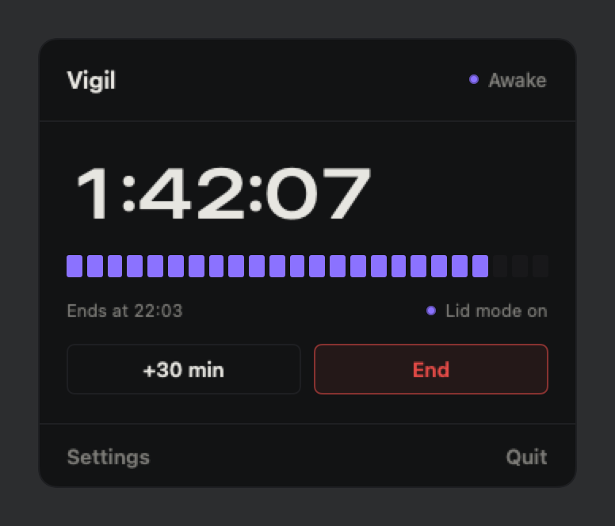

# Vigil

Keeps your Mac awake for a set time, lid closed, and always ends.

<p align="center"></p>

Requires macOS 15 or later. A menu bar app, no telemetry. It uses the network only if you turn on phone pings.

## What it does
- Timed sessions only: 30 min, 1 h, 2 h, 4 h, 8 h or your own length up to 24 h. There is no open-ended switch.
- Holds a power assertion so the Mac does not idle to sleep (and the display, if you ask).
- Lid closed: the Mac keeps running with the lid shut. Optionally it turns the display off and mutes the sound while the lid is closed, and it ends the session if the Mac stays hot for 2 minutes. A failed lid request shows as a hollow dot on the menu bar icon.
- Optional "Stay awake while my agents work": follows Claude Code and Codex, ends 10 minutes after work stops (12 hours at most), and can let the Mac sleep once all agents have waited for you for more than 30 minutes.
- Optional night schedule: starts a session at a set time each night and ends it at the end time. It skips the night if a session is already running or the battery is at or below your floor.
- Optional phone pings through ntfy: a short message when a session ends, agents finish, the Mac gets too hot, or an agent has waited over 15 minutes. Project names are left out unless you ask for them.
- Settings explain how to make macOS join your iPhone hotspot when Wi-Fi drops; Vigil doesn't change that setting.
- The night strip: 24 LED segments under the countdown go dark one by one as time runs out.
- Ends itself: on time, on End (hold 0.6 s), on Quit, or when the battery drops to a floor you set.
- Optional "when you're away": after N minutes without input, quits Dock apps that are not on your keep list, once per away period. The default keep list covers terminals, editors, browsers, and notes and mail apps.
- Shows a quiet note if Insomnia is running too.

## Install

**Homebrew**

```
brew tap noterikkirillov8/tap
brew trust noterikkirillov8/tap
brew install --cask vigil
```

**Download**: get `Vigil-1.0.0.zip` from [Releases](https://github.com/noterikkirillov8/vigil/releases), unzip it and drag `Vigil.app` to Applications.

**Build from source**: see below.

Vigil isn't notarised by Apple (that needs a paid developer account), so the first time macOS may say it can't verify the developer: open System Settings → Privacy & Security, scroll down and click Open Anyway (on macOS 15 and later right-click → Open no longer works). The Homebrew cask clears that flag for you. Lid mode needs a one-time setup command; the panel offers to copy it the first time.

## Safety
- Use it on a hard, ventilated surface. Never in a closed bag: a running Mac with the lid shut gets hot.
- Every session has an end. Normal end, End, Quit and app termination all restore normal sleep.
- A detached watchdog restores sleep within seconds if Vigil crashes or hangs, and a state file makes the next launch restore it too.
- A tiny login agent (`~/Library/LaunchAgents/com.erikkirillov.Vigil.backstop.plist`), installed the first time a lid session starts successfully, covers a restart or crash mid-session: at login and every 5 minutes, if a lid session was left on and Vigil is not running, it turns sleep back on.

## How lid mode works
Starting a session runs `/usr/bin/sudo -n /usr/bin/pmset -a disablesleep 1`; ending it runs the same with `0`. For `sudo -n` to work without a password you add a one-time sudoers rule. If it is missing, the session still runs without lid mode and the panel shows "Lid mode needs a one-time setup" with a button that copies the command. Vigil never runs that command itself.

## Network
Only phone pings use the network, and only when you turn them on: Vigil makes a plain HTTPS POST to `https://ntfy.sh/<topic>`, where the topic is a random `vigil-` name it generates. Anyone who knows the topic can read the pings, so don't share it. The messages are fixed sentences; project names (up to three folder names) are added only if you switch that on. For agent state Vigil runs the local `claude agents --json --all` command and reads `~/.codex/sessions`.

## Not included
Network failover, browser throttling, app freezing, tmux keystrokes, update checks and an open-ended toggle.

## Build from source
```
./scripts/test.sh                 # logic tests (headless, fake power control)
./scripts/qa.sh                   # renders every state to qa/ off-screen
NO_OPEN=1 ./scripts/install.sh    # Release build into /Applications, not started
```
Requires Xcode and XcodeGen. Release is signed with a local identity when present, ad-hoc otherwise.

## Privacy
Nothing leaves your Mac unless you turn on phone pings (see Network). Vigil keeps settings in UserDefaults and one small state file in Application Support while a lid session is active.

Licence MIT. Sounds are real recordings from Freesound (CC0); see Vigil/Resources/Sounds/SOURCES.md.
